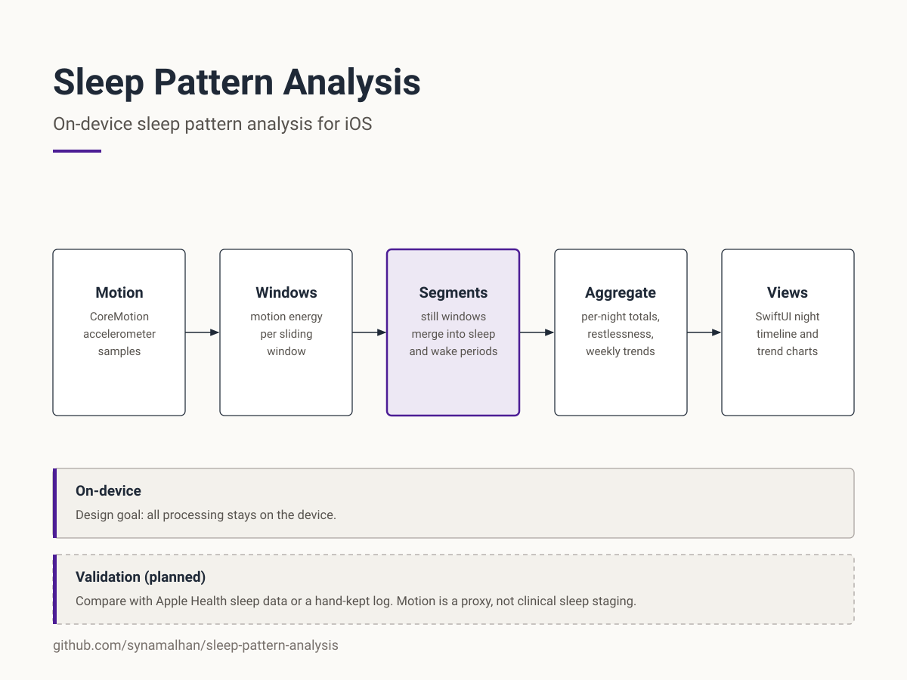

# Sleep Pattern Analysis

On-device sleep pattern analysis for iOS.

> **Status: in progress.** The original repo was lost and is being rebuilt. This repo currently holds the design only, and no results are reported until they are measured.

The app reads motion data with CoreMotion, finds still and moving windows, groups them into likely sleep periods, and shows per-night summaries and trends in SwiftUI. The design goal is that all processing stays on the device.

## Architecture

## Plan

- [ ] CoreMotion capture
- [ ] Sliding-window motion detection
- [ ] Sleep and wake segmentation
- [ ] On-device aggregation: nightly totals, restlessness, weekly trends
- [ ] SwiftUI timeline and trend views
- [ ] Validation against Apple Health sleep data or a hand-kept log

## Validation (planned)

Compare detected periods with a reference. Motion is a proxy, not clinical sleep staging.

## Planned stack

Swift, SwiftUI, CoreMotion.
